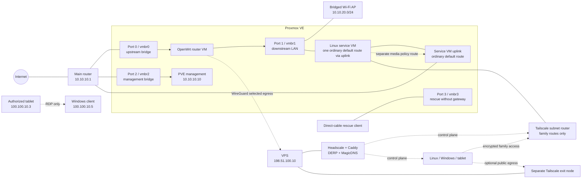

# Home Network Infra

This repository describes a segmented home network with anonymous example data.
It includes Proxmox VE, an OpenWrt router VM, a Linux service VM, and self-hosted applications.
Headscale connects remote clients to household services and a separate VPS exit node.
Only one authorized tablet can use Windows remote desktop.

The repository contains source and architecture documents.
It excludes credentials, real deployment addresses, local identities, and records from the running network.
Offline checks cover the public examples.
They do not prove that the complete public system works in a new live deployment.

## Architecture



The WireGuard router and Tailscale exit node serve separate traffic paths.
Family subnet routes stay on the service VM when a client selects the VPS exit.
The service VM uses its uplink for its ordinary default route.
A separate media policy route also uses that uplink.
The rescue bridge has no default gateway.
It must not become another uplink.

The downstream access point (AP) bridges Wi-Fi to the local area network (LAN).
This does not show that a disabled hypervisor wireless device works.

## Components

| Layer | Purpose | Reference |
| --- | --- | --- |
| Virtualization | Four port roles, VM start order, rescue, GPU checks | [Infrastructure](docs/infrastructure.md) |
| Router egress | WireGuard, direct fallback latch, explicit recovery, LuCI | [Infrastructure](docs/infrastructure.md) |
| Remote network | Headscale, DERP, subnet routes, separate exit, MagicDNS | [Infrastructure](docs/infrastructure.md) |
| Home applications | Jellyfin, offline PDF/OCR, Homepage, files, container management | [Services](docs/services.md) |
| Windows | TUN routes, protected maintenance tasks, tablet-only RDP | [Windows](docs/windows.md) |
| Operations | Dependencies, checks, recovery | [Operations](docs/operations.md) |
| Privacy | Publication rules and source coverage | [Publication](docs/publication.md) |

## Access model

| Source | Family services / approved LANs | VPS exit | Windows RDP | Other Windows services |
| --- | --- | --- | --- | --- |
| Linux client | Allowed | Optional | Denied | Denied |
| Windows client | Allowed | Optional | Local host | No new inbound grant |
| Authorized tablet | Allowed | Optional | TCP/UDP 3389 only | Denied |
| Subnet router | Route forwarding only | No client grant | Denied | Denied |
| VPS exit node | Approved internet forwarding | Exit role | Denied | Denied |
| Other LAN / tailnet device | No implied grant | No implied grant | Explicitly blocked | No new grant |

Remote Desktop Protocol (RDP) access needs both the Headscale policy and Windows firewall permission.
The allow rules match the tablet address, Windows address, Tailscale interface, and `TermService`.
Complement rules block other IPv4 sources and all IPv6 sources.
A DNS name does not grant access.
Keep Network Level Authentication (NLA) and Transport Layer Security (TLS).
Use the account password in Windows App, not a Windows Hello PIN.

## Configure and inspect

Python 3.10+ can run the root renderer, privacy scanner, and unit tests.
Component documents list other dependencies for offline checks or deployment.

```sh
python -m pip install -r requirements-dev.txt
python scripts/check_publication.py
python -m unittest discover -s tests -v
python scripts/check_offline.py
python scripts/render.py --site config/site.example.json --output build/example
python scripts/validate.py --rendered build/example
```

The renderer writes local reference files only.
It does not contact servers or change routes and firewall rules.
A `.tmpl` file replaces the static example at the same output path.
Rendering does not make hardware-specific reference code a general installer.
Component documents and tests identify these limits.

The diagram shows the netplan reference with an uplink default route.
The retained Jellyfin guard requires a different initial default through `ens18` and `10.10.20.1`.
Do not apply that guard unchanged to the netplan layout.
Coordinate the host layout, guard, and tests before deployment.
See [Services](docs/services.md) for this compatibility boundary.

1. Select a new or empty output directory.
2. Copy the site example to an ignored `config/site.local.json`.
3. Change the private site values for the target network.
4. Copy `.env.example` to an ignored `.env`.
5. Enter the secret values in the local `.env`.

Family and rescue networks use `/24`.
The WireGuard pair uses `/30`.
Container networks use fixed values in the guards and tests.
To change those values, change the component and its tests together.
Read each component's ownership and rollback requirements before an explicit apply command.
Do not run all maintenance scripts in sequence.

| Example role | Network or name |
| --- | --- |
| Upstream | `10.10.10.0/24` |
| Downstream | `10.10.20.0/24` |
| Rescue | `10.10.99.0/24` |
| Tailnet | `100.100.10.0/24` |
| Public VPS | Documentation address only |
| Control / internal DNS | `hs.example.com` / `tail.example.test` |

Replace the example domains and public address with private deployment values before deployment.

## Deployment order

1. Check the physical port mapping and direct rescue access.
   Configure the bridges and management path without a layer-2 loop.
2. Start the router VM and downstream LAN before the Linux service VM.
   Check the default route, GPU access, and application egress before workloads start.
3. Get the pinned images and model assets from their separate sources.
   Start the application guards before the services.
   Check both allowed and denied paths.
4. Configure the VPS control server before client enrollment.
   Approve family subnets only on the subnet router.
   Approve default routes only on the separate exit node.
5. Add the individual device grants and host firewall rules.
   Check tablet RDP from an external network by address, then by MagicDNS name.
   Test rejected sources last.

## License and provenance

Original code and documentation are licensed under [MIT](LICENSE). See
[third-party notices](THIRD_PARTY_NOTICES.md) and component-local licenses for
upstream material. Model weights, media subscriptions, backups, screenshots,
private keys, original state databases and deployment receipts are excluded.

GitHub shows the repository owner in the repository URL.
The repository content and anonymous commit identity exclude the source operator's local identity and deployment addresses.
