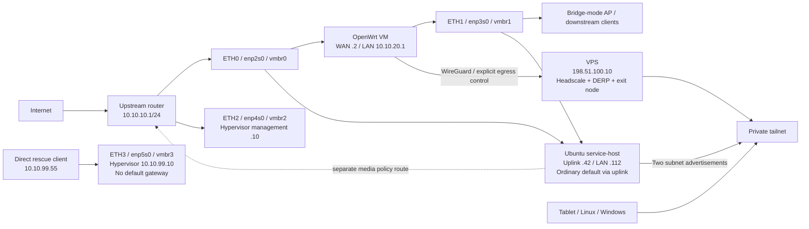

# Infrastructure and network architecture

This design comes from a private installation.
The public examples use invented addresses and device identities.
Offline checks of these files are separate from historical tests of the original installation.
They do not prove a new deployment, reboot, traffic path, or recovery.

## Physical layout and routing

ETH0 carries the router WAN and service VM uplink.
ETH2 supplies hypervisor management.
ETH1 forms a separate broadcast domain.
Do not connect ETH1 to the upstream LAN.
ETH3 uses a direct rescue cable and static address.
It has no default route and does not depend on the router VM.

The downstream access point uses bridge mode.
The design does not need wireless passthrough to OpenWrt.

| Role | Example address | Default route |
| --- | --- | --- |
| Upstream router | `10.10.10.1` | ISP |
| Hypervisor management | `10.10.10.10` | Upstream router |
| Hypervisor rescue | `10.10.99.10` | None on this interface |
| OpenWrt WAN / LAN | `10.10.10.2` / `10.10.20.1` | WAN or controller-selected WireGuard public egress |
| Service host uplink / LAN | `10.10.10.42` / `10.10.20.112` | Upstream router only |
| Linux / service host / tablet / exit / Windows | `100.100.10.1` through `.5` | Explicit client exit choice |

The example MAC addresses are synthetic.
Reference migrations check one exact port layout and refuse other hardware.
They check MAC addresses, fresh SSH access, immutable files, and Address Resolution Protocol (ARP) conflicts.
They also protect VM and VFIO files and retain timed rollback.
Adapt and test these protections together.
They do not discover hardware or supply general provisioning.

## OpenWrt egress and accounting

The `vpn-egress` controller owns one IPv4 policy table and complete priority/selector pairs.
It refuses foreign rules at reserved priorities.
Special-use networks and the WireGuard endpoint use the main table to prevent tunnel recursion.
A probe rule checks the candidate path before the controller installs the production rule.
The controller does not change saved HomeProxy nodes or subscriptions.

`WG_ACTIVE` means the checked WireGuard path owns public traffic.

`DIRECT_LATCHED` records an intended WAN path after a manual switch or failed health checks.
It prevents automatic recovery to WireGuard.
Successful cleanup moves public traffic to the WAN.
An ownership conflict can prevent cleanup.
In that case, check `transport` and `routing_consistent` for the actual path.

The saved mode alone does not prove a route change.
Recovery to WireGuard needs an explicit resume action.
This prevents repeated automatic route changes.
The fallback favors availability and is not a privacy kill switch.

LuCI sends named actions through its remote procedure call (RPC) helper.
The helper serializes actions and checks the status structure and endpoint identity.
It limits command duration and hides private keys.
The bandwidth collector owns an nftables table and tracks counter generations.
It handles resets, reboots, and period boundaries.
It records gaps without inventing totals.

The counters include protocol overhead.
They are not ISP billing measurements.

The old proxy guard is an optional integration from the original network.
This repository does not include its installer.
Some readiness checks and retention paths still name it.
For a WireGuard-only router, omit or explicitly adapt those checks.
The repository excludes original subscriptions and proxy node data.

## Service VM and GPU

Create the router VM before the service VM.
The examples set OpenWrt to start order 1 with a 30-second delay.
The service host uses start order 2.
Keep the serial console and guest agent.
Supply disks, boot media, UUIDs, EFI variables, and PCI addresses from the private deployment.
The examples do not copy hardware identities.

The service host has two network interfaces and one ordinary default route through its uplink.
The downstream interface uses a reserved DHCP lease without routes or DNS from DHCP.
Services can accept direct household access from either subnet.
The separate media policy route keeps media egress independent of OpenWrt's public egress policy.
Accepted Tailscale routes are more specific.
They must not add a competing ordinary default route.

This describes the netplan reference, not every retained component's required initial state.
The Jellyfin network guard requires the host default through `ens18` and `10.10.20.1`.
It rejects the uplink-default layout unchanged.
Coordinate that guard, host routing, and tests before deployment.
Do not remove the route check to force installation.
See [Services](services.md) for the retained profile's exact boundary.

Before GPU passthrough, inspect the target IOMMU group.
Keep an independent host console.
Select the VFIO or driver binding for that hardware.
The VAAPI checker supports an Intel `8086:46b3` device with `i915` only.
This hardware profile is not a general Intel installer.

The checker checks one render node and its access permissions.
It does limited local VAAPI work.
The operator controls resets, module changes, and firmware installation.
Keep audit output private and outside Git.

The Docker installer checks supported Ubuntu releases and conflicting package families.
It protects existing workloads and uses Docker's official repository.
It saves a receipt for the daemon configuration.
On failure, it restores that configuration without deleting workloads or automatically removing packages.
Services still need their network and application guards.
See [Services](services.md).

## Headscale, relay, DNS and authorization

Headscale accepts loopback HTTP behind Caddy.
Metrics and gRPC also stay on loopback.
The administrative command line uses a private Unix socket.
The Caddy fragment exposes only client-control and DERP paths.
Configure public DNS and a trusted certificate for the real private site.
The example `hs.example.com` and VPS address cannot serve a public deployment.

The embedded DERP region checks registered clients.
UDP STUN and HTTPS relay service use separate listeners.
A manual updater checks the official public DERP map within fixed limits.
After download, it checks all current ownership hashes again.
It replaces the map and receipt atomically and recovers on failure.
Deployment fetches the current upstream relay list instead of a historical network snapshot.

A relayed connection carries the same encrypted traffic and permissions as a direct connection.
Direct access depends on UDP and network address translation (NAT).

The service host advertises the uplink and downstream subnets only.
The separate VPS exit node advertises default routes.
Each client selects that exit explicitly.
Family subnet access does not force public traffic through the VPS.
Access needs both route approval and a policy grant.
Route approval alone does not authorize a client.

MagicDNS supplies `windows-client.tail.example.test` and `windows-client` to clients that accept tailnet DNS.
It changes name resolution, not RDP permission.
Keep DNS acceptance enabled for short-name remote desktop.
After a server DNS change, disconnect the mobile VPN.
Then reconnect the mobile VPN.
This Headscale version needs a server restart for DNS configuration changes.

A policy reload does not reload DNS.
See [Headscale DNS](https://headscale.net/stable/ref/dns/) and [Tailscale MagicDNS](https://tailscale.com/docs/features/magicdns).

| Initiating role | Household subnets / service host | Public exit | Windows ping | Windows RDP | Other peer management |
| --- | --- | --- | --- | --- | --- |
| Linux client | Allowed | Allowed | Denied | Denied | Denied |
| Tablet | Allowed | Allowed | Allowed | TCP/UDP 3389 only | Linux ping only |
| Windows client | Allowed | Allowed | Self | Self | Denied |
| Service host / exit node | No unsolicited grant | No client exit grant | Denied | Denied | Denied |

The policy retains five explicit grants and fourteen allowed/denied test scenarios.
It does not grant blanket access to a tailnet or shared user.
Enroll each node separately.
Read its actual assigned address into the private site file.
Render the access control list (ACL) again.

Do not infer a role from a numeric node ID.
Do not assume that a reused server assigns addresses in sequence.
Authorize the tablet's individual `/32`.
Apply the Windows rules that block other IPv4 sources and all IPv6 sources on RDP.
The design has no RDP port forwarding or discovery-port exception.

Structural ACL checks do not replace the server's policy compiler.
On a matching-version staging server, run `headscale policy check --file /path/to/candidate.hujson` before replacing the file policy.
Do not use the direct-database bypass against a running server.
The [pinned CLI implementation](https://github.com/juanfont/headscale/blob/v0.29.5/cmd/headscale/cli/policy.go) defines this check boundary.

## Deployment, maintenance and recovery

### Prepare the host and router

1. Create a private site configuration outside the checkout.
   Render and inspect the examples.
   Run the offline checks.
   Keep credentials empty until the private target files are ready.
2. Label and check all four ports through a local console.
   Configure rescue access before uplink management.
   Review the reference handoff code before adapting a migration.
   Keep rollback armed until fresh-path checks pass.
3. Configure OpenWrt WAN, LAN, DHCP, and firewall zones.
   Keep upstream administration disabled until an explicit restricted-source rule is necessary.
   Check downstream DHCP.
   Make sure the two LANs have no bridge connection.
4. Install WireGuard from an official source or package.
   Supply peer credentials privately.
   Check endpoint routing and forwarding.
   Install the egress controller, LuCI, and accounting components.
   Test direct mode, resume, and failure latching before unattended use.
5. Configure Ubuntu networking, the guest agent, GPU profile, and Docker.
   Test service access on both LANs.
   Check the single intended ordinary default route.

### Prepare remote access

1. In fresh Headscale staging, run `fetch-artifact.sh`.
   Run `python3 fetch-derp-map.py derp-public.yaml`.
   Review `install-files.sh` before use.
2. Install and check the files without starting Headscale.
   Configuration tests create keys and open SQLite as the service user.
   Merge and check Caddy separately.
   Add only necessary firewall openings in the correct existing zone.
   Start Headscale after these checks.
3. Enroll clients interactively.
   Approve the service host's two subnets.
   Configure the separate exit node.
   Render and check the real `/32` role policy.
   Add Windows RDP and TUN coexistence protections.
4. Test household services, public egress, and DNS from an external mobile network.
   Test tablet remote desktop by short name.
   Test rejected RDP from another authorized node.
5. Test simultaneous Windows TUN and exit modes with the [Windows procedure](windows.md).
   Keep the RDP scope unchanged.

Do not publish enrollment URLs, request tokens, node state, or private keys.

### Backups and routine changes

Back up VM100 through the scheduled hook.
Use pinned SSH for off-machine copies.
The pull program checks completion logs, backup identity, and digest.
It refuses files that a process still holds writable.
It removes local copies only under its manifest ownership rules.
Its root-private configuration supplies the SSH key and known-hosts paths.

The repository includes neither private path.
Test restore in isolation before relying on a backup.
Never treat live receipts, VM backups, or database directories as cache.

Before a change, save a private backup of the current state.
Record the owner of each affected resource.
Check the candidate before an explicit apply action.
Use receipt-bound rollback when the component supports it.
If ownership hashes, bridge membership, or protected files differ, stop and inspect the cause.
Do not remove the guard.

A fresh-install DERP receipt has no previous configuration.
Its `restore` action refuses for that reason.
Restore a previous configuration only when a matching private overlay backup exists.

CI and static tests cannot prove wiring, NAT traversal, mobile DNS, GPU passthrough, cold starts, or isolated restore.
Test these on the target deployment.
Keep the resulting evidence outside the public repository.
