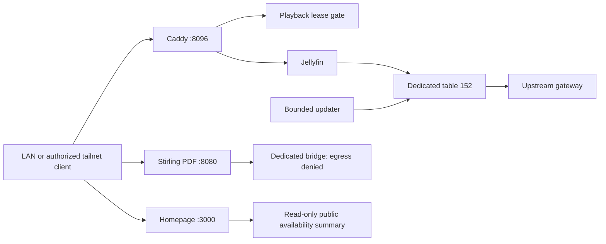

# Service architecture and operations

## Trust and data flow

The service host connects to the downstream LAN and the upstream LAN. The upstream interface is `jf-uplink`.
Tailscale permits service access from exact approved client addresses.
The Jellyfin media container and its scheduled updater use policy table 152 and the direct upstream gateway.
If that route fails, an unreachable default remains. The firewall blocks an alternate path for media traffic.

The retained Jellyfin guard requires exactly one host main default through `ens18` and downstream gateway `10.10.20.1`.
It refuses any other main default.
The Ubuntu host template instead uses the ordinary upstream default.
That template cannot directly use this Jellyfin guard.
Coordinate the component route requirements before deployment.
Keep the route ownership checks when adapting the guard to a different main route.



| Service | Host port | Private network | Host paths |
| --- | --- | --- | --- |
| Jellyfin gateway | TCP 8096 | `172.28.40.0/28` | `/srv/jellyfin` |
| Offline PDF | TCP 8080 | `172.28.50.0/28` | `/srv/stirling-pdf` |
| FileBrowser | TCP 8081 | `172.28.60.0/28` | `/srv/files`, `/srv/home-tools` |
| Portainer | TLS 9443 | `172.28.60.0/28` | `/srv/home-tools/portainer` |
| Homepage | TCP 3000 | `172.28.60.0/28` | `/srv/home-tools/homepage` |

These addresses are examples. Bindings to `0.0.0.0` depend on the matching nftables guard.
Install the guard before the containers start. Test the guard before the containers start.
Do not forward these ports from the internet.

The guards permit both LAN ranges and three exact tailnet clients: `100.100.10.1`, `.3`, and `.5`.
Headscale policy adds a separate access check.
The Windows RDP rules do not grant access to service administration.

## Deployment inputs

Test the sources on a disposable Linux host first.
The host needs Python 3, systemd, nftables, Docker Compose, iproute2, and the rendered site configuration.
The updater uses Python 3.13. OCRmyPDF uses version 17.13.0.

Review the interface names and hardware group IDs for the target host.
The example Intel render-device mapping needs local hardware setup. It does not discover hardware.

## Prepare the files

1. Render the site configuration.
2. Review each generated guard with its Compose file.
3. Create new root-owned application directories.
4. Stage the pinned images and assets while internet access is available.
5. Build the Caddy image from `jellyfin/Dockerfile.caddy`.
6. Tag the image as `local/jellyfin-caddy:no-file-capabilities`.

Do not reuse a database or an ownership receipt from another deployment.
The Caddy image has no file capabilities. Git does not contain the built image.

## Create local credentials

Keep all credential files outside the repository.
Portainer reads a mode-600 password file at `/run/secrets/portainer_admin`.
FileBrowser needs an administrator password in its private configuration.
Jellyfin needs initial administrator setup, a restricted API key, and a private gate-key JSON file with `api_token`.
Read each shipped reader before creating its input schema. Do not log credential contents.

## Install the guards and stacks

1. Install each guard in the path named by its systemd unit.
2. Review every approved /32 in `membership.example.json`.
3. Create the local Jellyfin approval record at `/var/lib/headscale-lan-guard-migration/migration.json`.
4. Set the root-owned directory to mode 700.
5. Set the record to mode 600.

This record records local approval. It is not a production receipt from another system.

1. Install the Jellyfin early firewall before Docker can restore containers automatically.
2. Install the Jellyfin direct-route guard.
3. Test refusal of foreign tables, occupied routes, and unexpected receipts.
4. Start the guarded stacks.
5. Run the unprivileged Homepage summary once before Homepage starts.
6. Enable the summary timer.

The Docker drop-in refers only to the Jellyfin early firewall.
Home Tools uses `restart: "no"`. Systemd controls its lifecycle.

The public status JSON contains availability only. It contains no response bodies or credentials.
Private HTTPS probes accept self-signed certificates. They do not test certificate validity.

## Configure media and OCR

1. Copy `jellyfin/channels.example.json` to the local `channels.json`.
2. Configure only media feeds that you can access lawfully.
3. Select local schedules within the update budget.
4. Test a small local feed.
5. Enable the update timers.

The example timers run at 02:00 and 14:00 UTC.
The repository contains no original channel choices or viewing preferences.
Keep source credentials outside public URLs. If an update fails, the current or last-good generation remains.

For OCR, stage the assets described below.
Review the reference Compose, wrapper, guard, and systemd units as one set.
The reference does not install an unattended deployment.

## Offline OCR and web patches

`stirling-pdf/assets/models.lock.json` lists the official detector and Small recognizer assets.
It records repository names, immutable commits, download URLs, and SHA-256 values.

1. Download the four files into `det/` and `rec-small/`.
2. Check every checksum against the manifest.
3. Stage the models outside Git.
4. Download the wheels from `requirements-runtime.lock` into a private staging area.
5. Install the wheels with `--no-index` in a dedicated virtual environment.

Seal the virtual environment after installation.
The repository distributes no wheels, model weights, training data, or PDFs.
Mount the sealed environment, model directories, and reviewed `ocr/` sources read-only at `/usr/local/share/stirling-paddle-order2-lab`.
Use the wrapper to permit one OCR job and one serialized request.
Keep the 900-second deadline and final kill deadline.

The image uses a private systemd slice with zero swap.
The helper checks the parent and container cgroup scope.

The network guard sets container DNS to loopback and denies outbound traffic.
These limits do not guarantee that every maximum-size input fits in memory.

In automatic mode, the Paddle bridge selects supported language sets that contain Chinese.
Explicit Tesseract, English-only, unsupported languages, and sandwich mode retain native Tesseract.

`assets/tesseract-extra.lock.json` records the official commit and checksum for the optional extra native language model.
An inference error fails the request. It does not silently switch engines.
The clean, deskew, and rotate controls remain per request.

Geometry uses approximate CTC/crop positions. It does not measure glyph outlines.
The renderer checks its own source and the supported upstream OCRmyPDF renderer digest.

`web-patch/build_patch.py` builds two limited v3.1.0 UI fixes from source.
Get the exact upstream assets separately. Check the input hashes before the build.
The builder refuses changed assets and missing or duplicate anchors.

Git excludes generated JavaScript, HTML, payload archives, and upstream bundles.
The builder does not install the patch.
Its companion test needs the locally generated artifacts. Source-only CI excludes that test.

## Recovery

Create private root-only backups of application data and configuration before deployment.
A guard receipt belongs to an exact source and rule identity.
Do not edit a receipt to bypass a refusal.

If the guard detects a change:

1. Stop the owned containers.
2. Compare the active files with the reviewed local source.
3. Restore the matching configuration and rules.
4. Repeat the guard checks.
5. Start the containers.

Do not flush global nftables rules. Do not replace routes in the main table.

| Component | Required recovery condition |
| --- | --- |
| Home Tools | Stop the stack before `network_guard.py --remove`. Removal refuses live containers and changed or foreign tables. |
| Jellyfin | Stop media and update units before guard removal. Normal guard shutdown retains the unreachable default and firewall. |
| PDF | `--remove` previews the change until `--execute`. Removal requires stopped units and stopped project containers. |

Restore application files and model mounts from the matching local backup.
Keep the firewall closed during restoration. Then repeat the guard and stack checks.

## Tests and deployment acceptance

Run the source-only service checks:

```text
python -B services/home-tools/test_network_guard.py
python -B services/tests/test_service_contracts.py
```

Linux tests import native `fcntl`. Windows tests use a stub only for pure functions and mocks.
Offline tests do not call nftables, Docker, service management, media feeds, or OCR inference.
A new deployment needs these live tests:

- Authorized client access and refusal of unauthorized or IPv6 clients
- Route loss and cold start
- Recovery after scheduler failure
- Playback leases with two clients
- OCR quality and resource use with representative inputs

The private source system had live checks. Those checks do not prove that these public templates work in a new deployment.

## Source coverage and licensing

| Original source family | Public content |
| --- | --- |
| Home Tools runtime, Homepage configuration, status collector | Synthetic addresses replace deployment addresses. Old remote bootstrap and credential exporters are absent. |
| Latest Jellyfin and PDF network guards | Source ownership checks and exact client allowlists remain. |
| Jellyfin tools archive | Playback gate, updater, route guard, Compose, Caddy configuration/build recipe, CLI, and systemd schedules. No actual channels, media, or acceptance output. |
| Paddle OCR tools archive | Inference/token bridge, plugin, layout, quad geometry, renderer, zero-swap helper, and dependency/model metadata. |
| Initial PDF installer/configuration generator | The supplied handoff did not contain this source. New reference Compose, wrapper, and units identify that source gap. |
| One-time OCR release/export/quality migrations | No reusable installer. They need private authenticated snapshots, exact historical ownership state, and excluded fixtures. The recovery conditions above still apply. |
| PDF UI fixes | Patch generator and test. No generated third-party payloads. |

Original project glue uses the repository MIT license.
The Paddle probe adapts limited PaddleX operations under Apache-2.0.
Its original license and notice are in `stirling-pdf/ocr/third-party`.
OCRmyPDF, Stirling-PDF, Jellyfin, Caddy, Homepage, Portainer, FileBrowser, and the models retain their upstream licenses.
A pin or source link does not change an upstream license.
